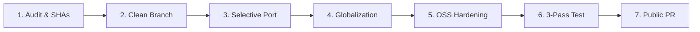

# Private Development to Open-Source Synchronization Audit & Runbook

## 1. Executive Summary

This document establishes the official synchronization audit and ongoing operational runbook for porting mature, production-grade capabilities from private development (`Rafiq-July`) into the canonical public open-source platform (`Rafiq-Bot`).

Rafiq is an open-source, English-first, culture-neutral, extensible AI companion platform with persistent personas, cognitive memory, emotional continuity, configurable inference providers, multimodal interaction, and privacy-preserving local storage.

### Synchronized Repository Provenance

| Repository | Role | Recorded Base SHA | State |
| :--- | :--- | :--- | :--- |
| **`imMamdouhaboammar/Rafiq-July`** | Private Development Source | `21ea1edc40ab9593703315a7695273e862643551` | Read-only reference |
| **`imMamdouhaboammar/Rafiq-Bot`** | Canonical Public OSS Destination | `6475cda55967c206f326d89c8af71d127de990dc` | Destination (`main`) |
| **Sync Feature Branch** | Staged OSS Release Branch | `feat/global-oss-sync` | Staged PR branch |

---

## 2. Feature Migration & Reconciliation Matrix

Each subsystem was evaluated against five release criteria: usefulness, safety, architecture compatibility, testability, and documentation completeness.

| Subsystem / Feature | Source Status | Target Classification | Architectural Action & Reconciliation |
| :--- | :--- | :--- | :--- |
| **Runtime Locale & Timezone** | Hardcoded Cairo / ar-EG | **Public-only improvement** | **Preserve**: Rafiq-Bot's `services/runtimeLocale.ts` cleanly separates UI language, conversation language, locale, timezone (UTC default), and text direction. |
| **English-First UI System** | Arabic strings in templates | **Public enhancement** | **Reconcile**: Introduced structured message catalog (`src/i18n/`) with English (`en-US.json`) default and full Egyptian Arabic (`ar-EG.json`) optional locale. |
| **Global Persona Archetypes** | Defaulted to Cairo character | **Public enhancement** | **Reconcile**: Added synthetic neutral companion `Nova` (`nova_default`) and `Alex` (`alex_default`) as global defaults. Preserved `Amira` (`amira_default`) as an optional Egyptian preset. |
| **Gemini Streaming Resilience** | Deadlock & disconnect fixes | **Private feature newer** | **Port & Reconcile**: Ported immediate SSE chunk streaming, keep-alive pings (12s), model fallback chains with exponential backoff on 429/503, and repair prompts while preserving `api/httpTypes.ts`. |
| **Neuro-Cognitive Engine** | Contracts, affect, journals | **Private feature newer** | **Port**: Ported `contracts/neuroCognitive.ts`, `services/syntheticAffect.ts`, `services/reflectionJournal.ts`, `services/insideJokesLedger.ts`, `services/memoryLifecycle.ts`, `services/smartRetrieval.ts`. |
| **Dexie V8 Schema & Worker** | Indexed tables & background | **Private feature newer** | **Port**: Ported `services/registerDbV8.ts`, `services/neuroDb.ts`, `services/rafiqBackgroundWorker.ts`, and `workers/chatKeepAlive.worker.ts`. |
| **Companion Duplication & Export** | Settings-only & sanitized export | **Private feature newer** | **Port**: Ported `services/companionDuplication.ts`, `components/ExportCompanionModal.tsx`, and v2 companion package export/import with 100% v1 backward compatibility. |
| **WhatsApp Rhythm Engine** | Typing delays & reactions | **Private feature newer** | **Port & Globalize**: Ported cognitive reading delay and bubble rhythm while expanding spontaneous reactions to be bilingual (English + Arabic). |
| **OmniTwin Cognitive Core** | Provenance & social planner | **Private feature newer** | **Port**: Ported pure TypeScript cognitive coordinator (`services/cognitive/*`), epistemic grounding verifier, associative Hebbian recall, and 12-move social planner. |
| **Interactive Storyteller** | Multi-chapter story engine | **Private feature newer** | **Port**: Ported `contracts/storyteller.ts`, `services/storyteller.server.ts`, `services/storytellerRepository.ts`, `services/storytellerService.ts`, and `components/StorytellerView.tsx`. |
| **Hardened CI & Security Gates** | Standalone Bun workflow | **Public-only improvement** | **Preserve**: Preserved pinned `.github/workflows/ci.yml`, read-only permissions, frozen Bun lockfile (`bun@1.4.2`), secret detection scripts, and contract test suites. |
| **OSS Manifests & Documentation** | Licensing, CITATION, guides | **Public-only improvement** | **Preserve**: Preserved MIT license, CITATION.cff, CONTRIBUTING.md, CODE_OF_CONDUCT.md, SECURITY.md, SUPPORT.md, and validated docs structure. |
| **Vulnerable Dependencies** | `proxy-addr@2.0.7`, `source-map-js@1.2.1` | **Security fix** | **Resolved**: Updated to `proxy-addr@2.0.8` and `source-map-js@1.2.2`, passing `bun audit --audit-level=high` with 0 vulnerabilities. |

---

## 3. Privacy, Security, and Compliance Verification

Before any commit is accepted into the OSS release branch:
1. **Zero Secret Policy**: No API keys, OAuth client secrets, session cookies, database connection strings, or cloud tokens are committed. Verified by `node scripts/security/scan-secrets.mjs`.
2. **Zero Personal Identifiers**: No local developer paths (`/Users/...`), personal emails, or real private correspondence are published. Verified by `tests/agentDocsContract.test.ts`.
3. **No Hidden Backend**: The application runs completely self-hosted using user-supplied API keys (Google Gemini, Vertex AI, OpenRouter, or local KoboldCPP).
4. **License Integrity**: All code is distributed under the existing MIT License without proprietary or source-available restrictions.

---

## 4. Reusable Maintainer Synchronization Runbook

Future synchronizations from private development to the open-source repository must follow this deterministic 7-stage workflow:



### Stage 1: Differential Audit
- Fetch both `origin` (public) and private development remotes.
- Record both `HEAD` commit SHAs.
- Inspect closed and open pull requests to avoid duplicate work.
- Map changes into the classification matrix: Preserve public-only, Port mature features, Exclude private-only/experimental.

### Stage 2: Clean Public Branch
- Checkout a fresh feature branch from public `main`:
  ```bash
  git checkout -b feat/<sync-topic> origin/main
  ```
- Never merge private commit history or private branch trees into the public repository.

### Stage 3: Selective Feature Porting
- Port only targeted subsystems that meet maturity criteria:
  - Unit test coverage exists.
  - Zero external uncompiled binary or Python daemon dependencies.
  - Adheres to existing TypeScript/React and Dexie architecture.

### Stage 4: Globalization & Internationalization
- Ensure any newly added UI strings are mapped to `src/i18n/messages/en-US.json` (English default) and `ar-EG.json` (Egyptian Arabic preset).
- Verify runtime defaults resolve to neutral parameters:
  - Locale: `en-US`
  - Timezone: `UTC`
  - Direction: `ltr`
  - Culture: `neutral`
  - Default Persona: `nova_default`
- Ensure cultural logic (prayer times, colloquial Egyptian street slang) remains opt-in via `isEgyptianReference` or explicit preset selection.

### Stage 5: OSS Hardening & Contract Validation
- Check for dependency vulnerabilities:
  ```bash
  bun audit --audit-level=high
  ```
- Run secret and tracked-file scanners:
  ```bash
  bun run security:scan
  ```
- Confirm all new environment variables in `server.ts`, `api/`, and `services/` are recorded in `.env.example` and documented in `docs/configuration/env-reference.md`.

### Stage 6: 3-Pass Verification Suite
- Pass 1 (Type Safety & Static Contracts):
  ```bash
  bun run typecheck
  bun run test:oss-contracts
  ```
- Pass 2 (P0 & Unit Regression Suite):
  ```bash
  bun run test:p0
  bun test
  ```
- Pass 3 (Production Bundle Build):
  ```bash
  bun run build
  ```

### Stage 7: Pull Request & Community Release
- Push branch to public remote:
  ```bash
  git push origin feat/<sync-topic>
  ```
- Open Pull Request against `imMamdouhaboammar/Rafiq-Bot:main` documenting:
  - Source and destination commit SHAs.
  - Migrated features and preserved public-only improvements.
  - Test and security audit results.
  - Verification matrix across desktop and mobile form factors.
